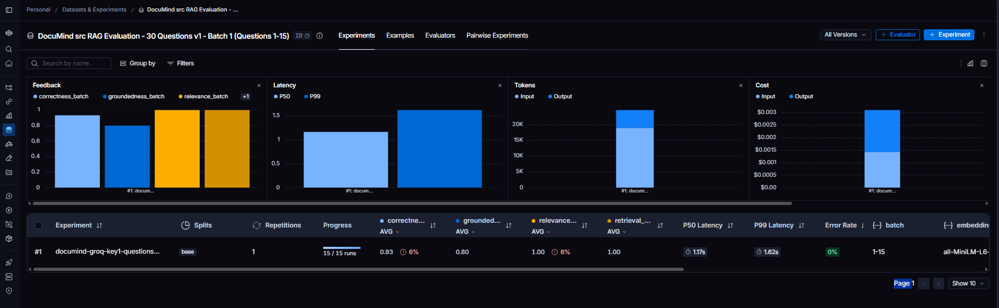
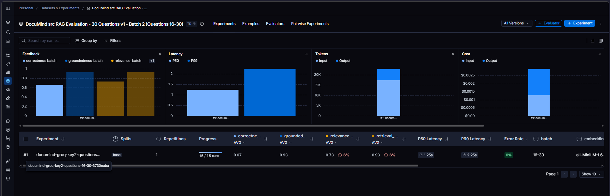

# DocuMind - Document Q&A with RAG

DocuMind is a Python-based Retrieval-Augmented Generation (RAG) project
that lets you ask questions about your documents. It provides **two ways
to run the RAG pipeline**:

1.  **Command-line/script mode** using `main.py`.
2.  **Interactive web UI** using Streamlit through `app.py`.

Both workflows use document loading, text chunking, sentence embeddings,
FAISS similarity search, and a Groq-powered LLM to generate answers from
retrieved context.

## Features

-   Supports PDF, TXT, CSV, XLSX, DOCX, and JSON files through the
    document loader.
-   Splits documents into overlapping chunks with LangChain text
    splitters.
-   Creates vector embeddings using Sentence Transformers
    (`all-MiniLM-L6-v2` by default).
-   Stores and retrieves vectors using FAISS.
-   Generates context-grounded responses using the RAG search pipeline
    and Groq LLM.
-   Offers a Streamlit chat interface with document upload,
    knowledge-base building, chat history, and source previews.
-   Provides a script-based workflow for running a predefined query from
    `main.py`.

## How it works

1.  **Load documents** from the selected data directory or uploaded
    files.
2.  **Chunk text** into smaller overlapping segments.
3.  **Generate embeddings** for each chunk.
4.  **Index vectors** and associated metadata in FAISS.
5.  **Retrieve relevant chunks** for a question.
6.  **Generate an answer** using the retrieved context and the
    configured Groq language model.
7.  **Return the answer** in the terminal or display it with source
    previews in Streamlit.

## Requirements

-   Python 3.10 or newer recommended.
-   A Groq API key for LLM-generated answers.

## 🖥️ Application Preview

[**Launch DocuMind →**](https://documind-rag-app.streamlit.app/)

## Setup

### 1. Clone the repository and open the project directory

``` bash
git clone https://github.com/0xfarben/DocuMind.git
cd DocuMind
```

### 2. Create and activate a virtual environment (recommended)

**Windows PowerShell:**

``` powershell
python -m venv venv
.\venv\Scripts\Activate.ps1
```

If you use Command Prompt:

``` bat
venv\Scripts\activate.bat
```

**Linux/macOS:**

``` bash
python3 -m venv venv
source venv/bin/activate
```

If your environment is already created, activate it rather than creating
another one.

### 3. Install dependencies

Install the dependencies listed in the project's `requirements.txt`:

``` bash
python -m pip install --upgrade pip
pip install -r requirements.txt
# pip3 install -r requirements.txt # Linux/MacOS
```

If a document loader reports that an optional dependency is missing,
install the package named in the error.

### 4. Configure the Groq API key

Create or update the `.env.example` to `.env` file in the project root:

``` env
GROQ_API_KEY=your_groq_api_key_here
```

Replace the placeholder with your API key. Ensure your code loads the
environment variable before initializing the Groq client.

## Method 1: Run the RAG pipeline using `main.py`

This method runs a predefined question from the terminal. Place the
documents you want to query inside the `data/` directory.

Run:

``` bash
python main.py
```

The script loads documents from `data/`, initializes the FAISS vector
store in `faiss_store/`, and checks whether the saved index files exist:

-   `faiss_store/faiss.index`
-   `faiss_store/metadata.pkl`

If both files exist, the script loads the saved index. Otherwise, it
builds the vector store from the documents and saves it. It then
initializes `RAGSearch`, runs the predefined question, and prints the
summary.

The current example question in `main.py` is:

``` python
query = "Why Machine Learning is required?"
summary = rag_search.search_and_summarize(query, top_k=3)
print("Summary:", summary)
```

To ask a different question, change the `query` value in `main.py`. To
rebuild the index from the current files in `data/`, remove or rename
the existing saved index and metadata files, or update the script to
rebuild explicitly.

**Important:** The `main.py` workflow uses the `src/` modules and the
`faiss_store/` directory.

## Method 2: Run the Streamlit web app using `app.py`

This method provides an interactive browser-based interface.

Run from the project root:

``` bash
streamlit run app.py
```

Streamlit will print a local URL, usually `http://localhost:8501`. Open
that URL in your browser.

### Using the web app

1.  Upload one or more supported documents: PDF, TXT, CSV, XLSX, DOCX,
    or JSON.
2.  Click **Build Knowledge Base**.
3.  Wait for the document processing and embedding steps to finish.
4.  Ask a question using the chat input.
5.  Review the answer and any displayed source previews.
6.  Use **Clear Chat** to clear the conversation.

**Important:** The Streamlit workflow imports modules from
`src_for_streamlit/`. Its upload and index persistence behavior is
managed by `app.py` and may differ from the `main.py` workflow. Do not
assume that the Streamlit knowledge base uses the same index as
`main.py`.

## Configuration

These are the typical values in the current pipeline; verify the values
in your source if you have changed them.

| Setting | Typical value | Description |
|---|---|---|
| Embedding model | `all-MiniLM-L6-v2` | Converts text into vectors |
| Chunk size | `1000` characters | Target maximum chunk size |
| Chunk overlap | `200` characters | Shared context between chunks |
| Retrieval count | `top_k=3` in `main.py` | Number of matching chunks |
| Vector index | FAISS `IndexFlatL2` | Nearest-neighbor search using L2 distance |


## Evaluation

DocuMind has been evaluated using a 30-question test set based on two technical PDFs. The test set checks answer correctness, answer relevance, grounding in retrieved context, and retrieval relevance. It includes single-document questions, cross-document questions, and questions that may not be answerable from the source documents.

### Test documents

- `Introduction to Machine Learning with Python.pdf` [**e-Book →**](https://www.nrigroupindia.com/e-book/Introduction%20to%20Machine%20Learning%20with%20Python%20(%20PDFDrive.com%20)-min.pdf)
- `2023KS_Narasimhan-A_Beginner's_Handbook_to_DevOps.pdf` [**e-Book →**](https://learning.dell.com/content/dam/dell-emc/documents/en-us/2023KS_Narasimhan-A_Beginner's_Handbook_to_DevOps.pdf)

### Test-set breakdown

| Category | Questions | What it checks |
|---|---:|---|
| Machine Learning | 15 | Answers grounded in the Machine Learning PDF |
| DevOps | 8 | Answers grounded in the DevOps PDF |
| Cross-document | 5 | Questions involving concepts from both PDFs |
| Unanswerable | 2 | Whether the system avoids inventing information absent from the PDFs |
| **Total** | **30** | |

### Automated LLM-as-judge evaluation

The automated evaluation was run through LangSmith using four evaluators. The 30 questions were processed in two sequential batches of 15 to make runs easier to manage and to help isolate failures.

| Metric | Score | Interpretation |
|---|---:|---|
| Correctness | **80.00% (24/30)** | Whether the answer matches the reference answer |
| Answer relevance | **86.67% (26/30)** | Whether the answer addresses the question |
| Groundedness | **86.67% (26/30)** | Whether the answer is supported by retrieved document content |
| Retrieval relevance | **96.67% (29/30)** | Whether the retrieved context is relevant to the question |
| **Macro-average across the four metrics** | **87.50%** | Simple average of the four metric percentages |

**How to read these scores:** Each metric is a separate binary LLM-judge assessment. The macro-average is the unweighted average of the four metric percentages; it is not a separate evaluator score or a guarantee that 87.5% of all answers are fully correct. Evaluator calls that initially failed were retried successfully. Missing/failed feedback should not be counted as an incorrect answer.

#### Metric score snapshot

- Correctness:         `████████░░` 80.00%
- Answer relevance:    `█████████░` 86.67%
- Groundedness:        `█████████░` 86.67%
- Retrieval relevance: `██████████` 96.67%

These scores are diagnostic estimates from the selected LLM judge, prompts, and test set. They are not an independent human-reviewed benchmark. Review individual examples and judge feedback in LangSmith, especially incorrect or borderline cases.

### Manual evaluation results

A separate manual test run was also reported for the same 30-question set:

| Measure | Reported result |
|---|---|
| Questions tested | 30 |
| Answer correctness | 30/30 reported correct |
| Source/citation correctness | 30/30 reported correct |
| Response latency | Reported under 5 seconds per question; most responses were around 3–5 seconds |

The manual results and automated LLM-as-judge results are different evaluation methods and should not be combined into one score. The manual results are developer-reported observations, not an independent review. Latency varies with network conditions, API response time, and deployment load.

### Evaluation metrics

- **Correctness:** Compares the generated answer with the reference answer for factual consistency.
- **Answer relevance:** Checks whether the answer addresses the question.
- **Groundedness:** Checks whether the answer is supported by retrieved document content.
- **Retrieval relevance:** Checks whether the retrieved context is topically relevant to the question. This is a broad relevance check, not a labeled Hit Rate@K or formal Context Precision metric.


### Evaluation Dataset Preview
<hr>




## Notes on accuracy and privacy

-   RAG improves answers by supplying retrieved document context, but
    LLM answers can still be inaccurate. Check the retrieved sources and
    original documents for important decisions.
-   Retrieved document text is sent to the configured Groq API for
    answer generation. Do not upload confidential information unless you
    are authorized to process it with that service.
-   If you change the embedding model, rebuild the corresponding vector
    index so document and query embeddings remain compatible.
