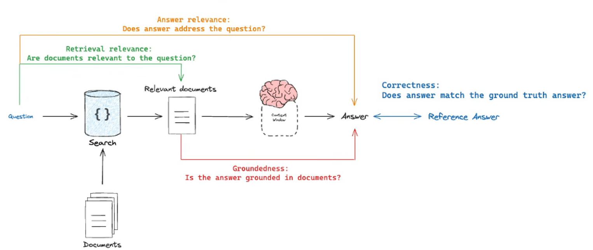

# DocuMind RAG Evaluation

This folder contains two ways to evaluate the DocuMind Retrieval-Augmented Generation (RAG) pipeline with [LangSmith](https://docs.smith.langchain.com/):

- **`DocuMind_RAG_Evaluation_Clean.ipynb`** — evaluates the 30-question dataset in sequential batches. This is useful when provider rate limits or long evaluation runs are a concern.
- **`DocuMind_RAG_Evaluation_Single_Run.ipynb`** — evaluates the complete 30-question dataset in one LangSmith experiment. This is simpler to run, but a larger single run may be more exposed to rate limits.

Both notebooks target `src.search_updated.RAGSearch`, use the project's FAISS index, and assess four dimensions of RAG behavior.

## Evaluation metrics

Each question is answered by the DocuMind RAG pipeline. Separate LLM-as-judge evaluators then assess the generated answer and retrieved documents.

| Metric | What it checks |
|---|---|
| **Correctness** | Compares the generated answer with the reference answer for factual consistency. |
| **Answer relevance** | Checks whether the answer addresses the question. |
| **Groundedness** | Checks whether the answer is supported by the retrieved document content. |
| **Retrieval relevance** | Checks whether the retrieved context is topically relevant to the question. |



The evaluation dataset contains 30 questions, including questions across the selected technical topics and questions that may be unanswerable from the available sources. Reference answers should be checked against the source PDFs before using scores in a report.

## How the evaluation works

1. **Configure credentials.** Load LangSmith and model-provider API keys from environment variables or a local `.env` file.
2. **Load the RAG implementation.** The notebook imports `RAGSearch` from `src.search_updated` and points it to `faiss_store/`.
3. **Prepare the dataset.** The notebook creates the 30-question LangSmith dataset if it does not already exist, or reuses the existing dataset.
4. **Run the target.** For each question, the target returns an answer and retrieved source documents.
5. **Run the judges.** Four evaluators score correctness, answer relevance, groundedness, and retrieval relevance.
6. **Review results.** Results are available as a LangSmith experiment and are converted to a pandas DataFrame for inspection and CSV export.

## Why batch evaluation?

The batch notebook divides the 30 examples into two sequential groups of 15. Each question invokes the RAG target and four judge evaluators, so a full run can make many model calls.

Batching is useful because it:

- **Limits the size of each run.** Smaller groups are easier to rerun and inspect.
- **Helps manage rate limits.** Sequential smaller runs can make the workload easier to manage, although batching does not guarantee that provider limits will not be reached.
- **Improves failure recovery.** If one batch fails, the other batch's results can remain available rather than requiring the whole dataset to be treated as one run.
- **Makes progress easier to monitor.** Each batch has its own experiment and result table.

Batching does **not** inherently improve evaluator quality or guarantee lower total token usage. It is primarily an execution and operational choice. If your provider has sufficient quota and you prefer simplicity, use the single-run notebook.

## Use a different LLM provider or model

The notebooks use Groq as the example judge provider and configure `openai/gpt-oss-120b` as the evaluator model. **You can use another LLM provider or model**—for example, a model accessed through OpenAI, Anthropic, Google, or another compatible SDK—by adapting the evaluator wrapper.

When switching providers, check that the replacement supports the features the notebook relies on:

- invoking a model with system/user messages;
- returning structured output that conforms to each metric's schema (or an equivalent parsing/validation step);
- appropriate credentials, quotas, and retry behavior.

The LLM used to **generate the DocuMind answer** is separate from the LLM used to **judge the answer**. Changing the judge provider does not automatically change the RAG pipeline's generation model. Keep provider-specific setup in the wrapper/configuration rather than scattering it throughout the evaluator functions.

## Setup

Run the notebook from the DocuMind repository root. The repository should contain `src/`, `data/`, and the FAISS index directory (or the code needed to build it).

Install the packages required by your project and the notebooks. The evaluation notebooks use LangSmith, LangChain's Groq integration in the example configuration, `python-dotenv`, `pandas`, and the project's existing dependencies. Use your project's dependency file where available.

Create a local `.env` file in the project root:

```dotenv
LANGSMITH_API_KEY=your_langsmith_api_key
GROQ_API_KEY=your_groq_api_key
```

## Choosing a notebook

| Choose this | When |
|---|---|
| **Batch notebook** | You want smaller sequential runs, easier progress tracking, and a more manageable recovery path if one run fails. |
| **Single-run notebook** | You want the simplest workflow and your provider quota can accommodate the full evaluation run. |

Run one notebook at a time to avoid unnecessary concurrent model calls and rate-limit pressure.

## Interpreting results and limitations

- The scores are LLM judgments, not independently verified ground truth. Inspect explanations and examples, especially borderline cases.
- Correctness depends on the quality of the reference answers.
- Groundedness depends on the content returned in the `documents` field and on the judge's interpretation of that content.
- Retrieval relevance is a broad topical-relevance check. It is **not** a labeled Hit Rate@K, Context Precision, or another formal retrieval metric.
- Unanswerable questions deserve separate review because judge behavior can vary when the expected response is to abstain.
- If the source PDFs change, rebuild `faiss_store/` before evaluating again.
- Results may vary with the judge model, prompt, provider, and model version. Record those settings when comparing experiments.

## Outputs

The notebooks show experiment results in the notebook and export a CSV under `evaluation/` for local review. LangSmith stores experiment traces and evaluator feedback when tracing and evaluation are configured correctly.

<br>